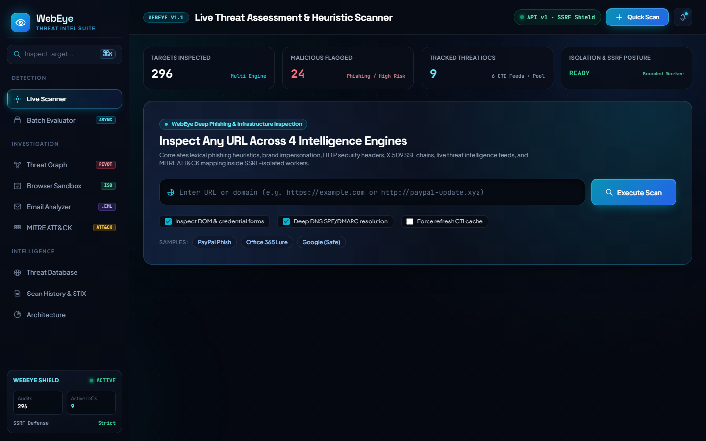
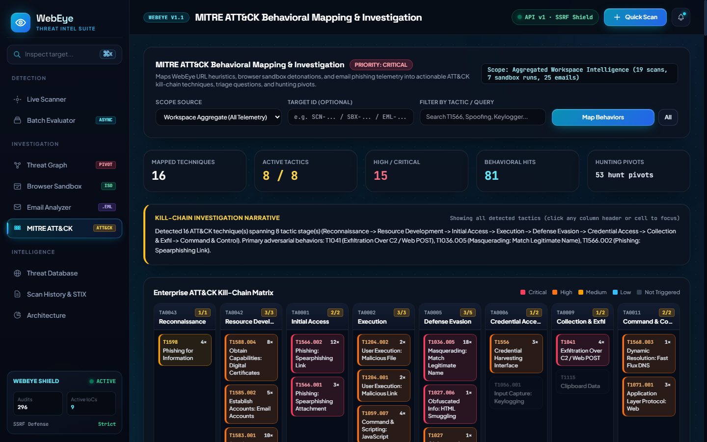

# 01. WebEye

**WebEye is an isolated, multi-engine phishing defense and cyber threat intelligence platform that detects deceptive URLs, emails, and adversary infrastructure with explainable risk scoring and MITRE ATT&CK investigation reports.**

[](https://python.org)
[](https://fastapi.tiangolo.com)
[](https://oasis-open.github.io/cti-documentation/stix/intro)
[]()

---

## 02. Problem

Modern phishing attacks bypass simple URL blocklists and single-signal scanners:

- **Ephemeral & obfuscated kits:** Attackers rotate fresh TLS certificates (`< 72h`), Unicode homoglyphs / Punycode domains, HTML smuggling payloads, and client-side JavaScript (`eval(atob(...))`, keyloggers) that static HTTP GETs miss.
- **Hidden campaign infrastructure:** Single-URL verdicts fail to reveal shared hosting IPs, certificate fingerprints, mail relays, or credential-exfiltration collectors spanning related domains.
- **Unsafe direct inspection:** Scanning attacker-supplied URLs or email attachments directly from an application server risks SSRF into cloud metadata/internal networks or host compromise.
- **Alert fatigue without actionable context:** Returning only a risk score or a bare ATT&CK ID forces SOC analysts to manually correlate headers, attachments, pivots, and containment steps.

---

## 03. Solution

**WebEye** unifies four correlated security engines with isolated execution sandboxes, threat-graph infrastructure correlation, and behavior-driven MITRE ATT&CK investigation reporting:

1. **Correlated 4-Engine URL Assessment (`0–100` Explainable Risk Score):**
   - **Heuristic Threat Analyzer (`35%`):** Shannon entropy, Unicode homoglyph / Punycode decoding, Levenshtein brand typosquatting, credential form & cross-origin exfiltration detection, obfuscated JS heuristics.
   - **Web Security & DNS Posture (`20%`):** Security header grading (`A+` to `F`), HSTS/CSP/clickjacking audits, DNS `A`/`MX`/`NS`/`TXT`, SPF & DMARC enforcement, redirect chain downgrade analysis, and fast-flux detection.
   - **SSL/TLS Certificate Validator (`20%`):** SNI X.509 handshake parsing, `< 72h` freshly-minted cert alerts, SHA-256 fingerprint & SAN validation, automated free CA profiling.
   - **Collaborative Threat Intelligence Hub (`25%`):** Persistent-cached lookups across VirusTotal v3, Google Safe Browsing v4, PhishTank, URLhaus (abuse.ch), AlienVault OTX, AbuseIPDB, plus community IoC peer consensus voting.
   - Full **Explainability Breakdown** tracks score drivers, engine confidences, and missing-evidence gaps.
2. **Threat Relationship Graph:** Connects domains, IPs, X.509 certificates, redirect URLs, hosting/DNS providers, and campaigns (`GET /api/v1/graph`) to surface shared adversary infrastructure pivots.
3. **Isolated Browser Phishing Sandbox:** Executes suspect URLs inside a separate headless Chromium subprocess (`CDP` over WebSockets + `Fetch.enable` SSRF enforcement) capturing viewport screenshots (`1366x768`), redirect chains, third-party requests, cross-origin forms, keyloggers, and runtime `eval`/exfiltration beacons.
4. **Email (`.eml`) & Isolated Attachment Forensics:** Parses MIME emails, runs cryptographic DKIM RSA-SHA256 verification and live DNS SPF/DMARC checks, detects display-name & `Reply-To` spoofing, flags deceptive hyperlink anchors, and inspects attachments in an offline restricted subprocess (magic-byte spoofing, archives, PE executables, macro markers, HTML smuggling).
5. **Behavior-Driven MITRE ATT&CK Mapping & Exports:** Maps URL, sandbox, and email behaviors across 8 Enterprise ATT&CK tactics (`TA0043`–`TA0011`) with observed evidence, analyst triage questions, hunting pivots, and SOC playbooks (`GET /api/v1/mitre`), alongside multi-technique **OASIS STIX 2.1 JSON** bundles and **ReportLab PDF Incident Reports**.
6. **Production Hardening:** Asynchronous bounded-concurrency batch scanning (`202 Accepted` + job polling/cancellation), API versioning (`/api/v1/*`), optional `X-API-Key` + `HS256` JWT auth, sliding-window rate limiting, SQLite WAL + tracked migrations + secondary indexes, structured redacted JSON logging, Prometheus `/metrics`, and `/health` + `/ready` probes.

---

## 04. Demo Links and a Screenshot

- **WebEye Command Dashboard (local):** `http://127.0.0.1:8000`
- **Interactive Swagger / OpenAPI Docs:** `http://127.0.0.1:8000/docs`
- **Health & Metrics Probes:** `http://127.0.0.1:8000/health`, `http://127.0.0.1:8000/ready`, `http://127.0.0.1:8000/metrics`
- **Live Hosted Demo URL:** *Add your deployed URL here after hosting*

### Screenshots





---

## 05. Tech Stack

- **Backend API & Concurrency:** Python 3.10+, FastAPI, Uvicorn, Pydantic v2, `asyncio` (`Semaphore` bounded worker pools)
- **Networking, Crypto & Security:** `httpx`, `aiohttp` (CDP sandbox WebSockets), `cryptography` (X.509 & DKIM RSA), `dnspython`, `PyJWT`, `lxml`, `esprima`, `python-whois`
- **Storage & Migrations:** SQLite (`WAL` mode, versioned `schema_migrations`, 14 secondary indexes)
- **Reporting & Threat Sharing:** `reportlab` (PDF Incident Reports), OASIS STIX 2.1 JSON exporter
- **Frontend UI:** Vanilla ES6+ JavaScript, HTML5 Canvas (Threat Relationship Graph), Tailwind CSS + custom Obsidian/Cyan Tactical CSS (`app/static/`)
- **Configuration & Testing:** `python-dotenv`, Python `unittest` + FastAPI `TestClient` (`95` automated tests)

---

## 06. Architecture

```text
+-----------------------------------------------------------------------------------+
|                        WebEye Dashboard UI  &  CLI  (cli.py)                      |
|  Live Scanner · Async Batch Queue · Threat Graph · Sandbox · .EML · ATT&CK Matrix |
+-----------------------------------------+-----------------------------------------+
                                          | HTTPS / JSON (/api/v1/*, /health, /metrics)
                                          v
+-----------------------------------------------------------------------------------+
|              FastAPI Application & Security Middleware (app/main.py)              |
|  • API Versioning (/api/v1) + Legacy Aliases   • API Key & JWT Auth (HS256)       |
|  • Sliding-Window Rate Limiter (Scan/Read)     • Redacted JSON Logs & Prometheus  |
+----+--------------------+--------------------+--------------------+---------------+
     |                    |                    |                    |
     v                    v                    v                    v
+--------------+  +---------------+  +-------------------+  +-----------------------+
| ScoringEngine|  | BatchJobMgr   |  | Browser Sandbox   |  | EmailPhishingAnalyzer |
| Bounded Pool |  | 202 Queue +   |  | Headless Chrome   |  | MIME + SPF/DKIM/DMARC |
| 4 Engines +  |  | SQLite State  |  | CDP + SSRF Proxy  |  | Offline Attachment    |
| Explainable  |  | Cancellation  |  | Screenshots & JS  |  | Subprocess Worker     |
+------+-------+  +-------+-------+  +---------+---------+  +-----------+-----------+
       |                  |                    |                        |
       v                  v                    v                        v
+-----------------------------------------------------------------------------------+
|  SSRF Guard & Restricted Worker (fetch_worker / safe_fetcher)  +  MitreAttackMapper|
|  Public-IP DNS Pinning · Redirect Re-Validation · Response Size & Memory Bounds    |
+-----------------------------------------+-----------------------------------------+
                                          |
                                          v
+-----------------------------------------------------------------------------------+
|    SQLite (WAL + schema_migrations)  |  Threat Graph Builder  |  STIX 2.1 & PDF   |
+-----------------------------------------------------------------------------------+
```

---

## 07. Setup and Run Steps

### Prerequisites
- Python `3.10+` (verified on Python `3.14`)
- *(Optional for live Browser Sandbox)* Google Chrome, Chromium, or Microsoft Edge installed locally

### 1. Install Dependencies
```bash
git clone <your-repo-url>
cd <repo-folder>
python -m pip install -r requirements.txt
```

### 2. Configure Environment *(Optional)*
Copy `.env.example` to `.env` if you want to enable optional CTI API keys, API authentication (`AUTH_REQUIRED=true` + `PHISHPULSE_API_KEYS`), or custom concurrency/rate limits:
```bash
cp .env.example .env
```

### 3. Start WebEye Server
```bash
python run.py
```
Then open **[http://127.0.0.1:8000](http://127.0.0.1:8000)** in your browser (or Swagger UI at **[http://127.0.0.1:8000/docs](http://127.0.0.1:8000/docs)**).

### 4. CLI Usage *(Optional)*
```bash
python cli.py scan "http://paypa1-security-verification.xyz/login"
python cli.py scan "http://paypa1-security-verification.xyz/login" --stix report.json --pdf incident.pdf
python cli.py iocs --limit 10
python cli.py stats
```

### 5. Run the Automated Test Suite
```bash
python -m unittest discover -s tests -v
```

---

## 08. Disclosures

- **Authorized & Defensive Use Only:** WebEye is engineered for phishing detection, SOC triage, incident response, and security research. Only analyze URLs, domains, and `.eml` samples you are authorized to inspect.
- **Local Development Defaults:** For seamless out-of-the-box local usage, `AUTH_REQUIRED` defaults to `false` unless `PHISHPULSE_API_KEYS` or `AUTH_REQUIRED=true` is set in `.env`. Before public or multi-user deployment, enable authentication, configure a persistent strong `JWT_SECRET_KEY`, and place the service behind TLS termination.
- **External Threat Intelligence APIs:** VirusTotal, Google Safe Browsing, PhishTank, URLhaus, AlienVault OTX, and AbuseIPDB lookups require valid API keys in `.env` for full coverage. When unconfigured or offline, WebEye degrades gracefully and surfaces missing-evidence gaps in scoring explainability rather than failing scans.
- **Browser Sandbox Dependency:** Dynamic Chromium rendering (`Browser Sandbox`) requires Google Chrome, Chromium, or Microsoft Edge on the host machine; if no binary is installed, the sandbox endpoint reports the missing runtime cleanly while static URL, email, graph, and ATT&CK capabilities continue working normally.
- **Single-Node Persistence & Queue Scope:** By default, WebEye uses local SQLite (`data/phishpulse.db` with WAL + migrations) and in-process `asyncio` bounded background tasks rather than external PostgreSQL or Redis/Celery services.

---

## 09. Track

- **Cybersecurity — Phishing Defense, Threat Intelligence & Automated SOC Investigation** *(update with your exact competition/track label if submitting to an event)*.
